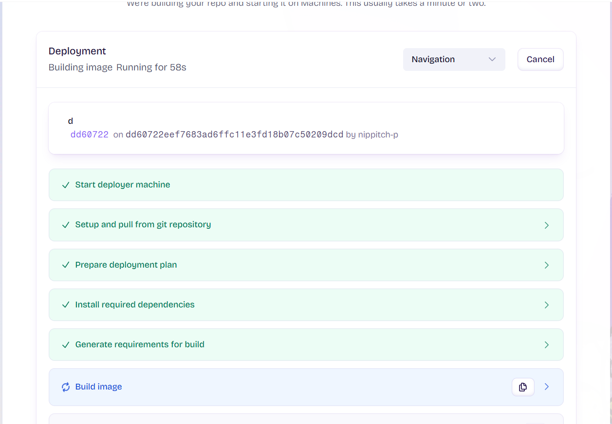
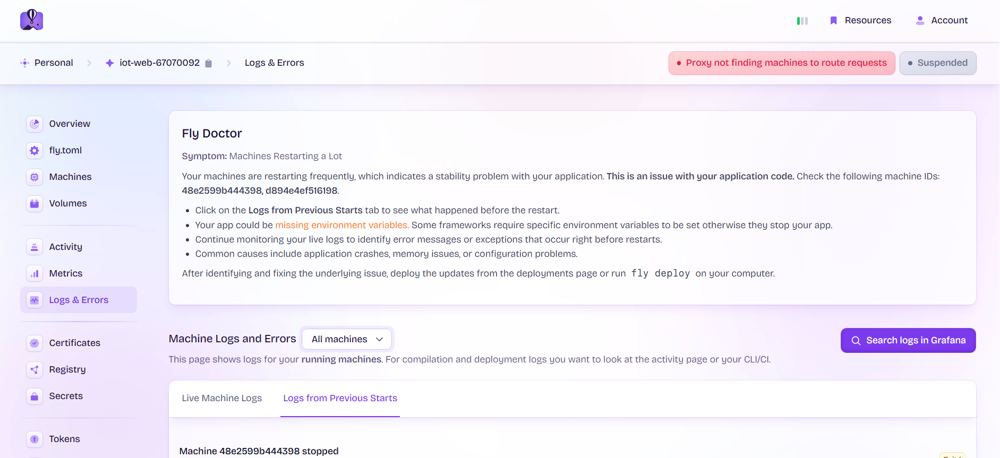
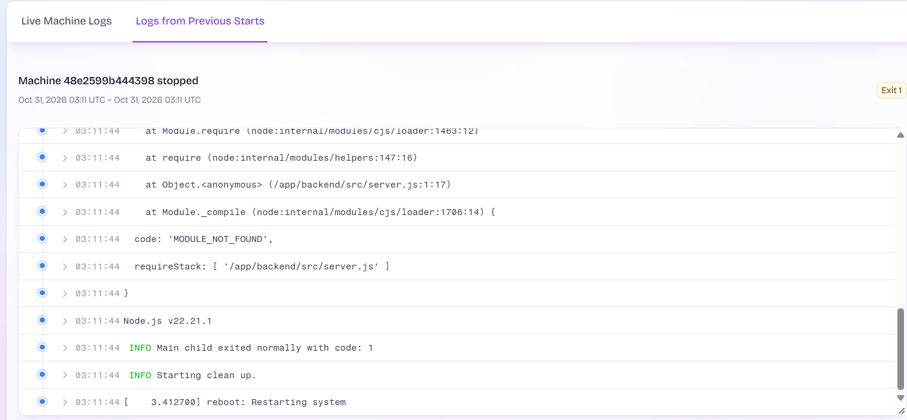
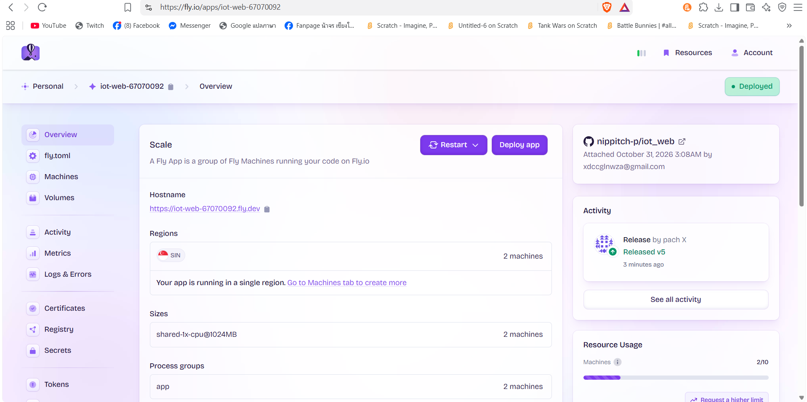
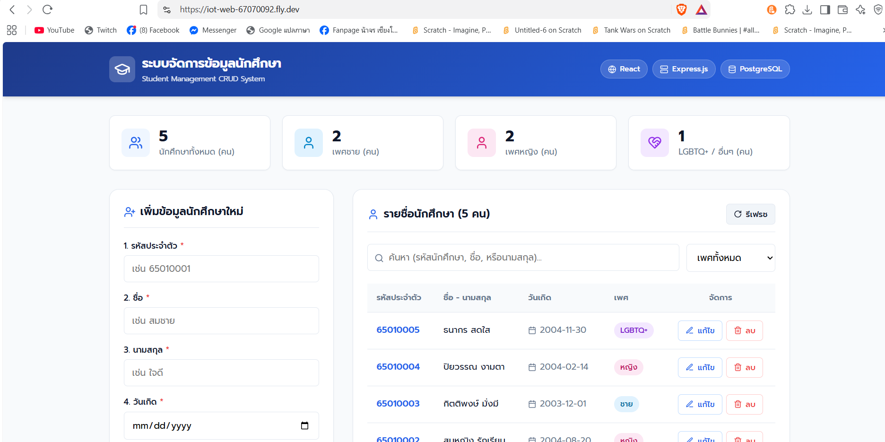

67070092 นิพพิชฌน์ คงห้วยรอบ

# สรุปรายงานการ Deploy ระบบขึ้น Cloud (Fly.io)

---

## 1. ขั้นตอนการ Deploy (ทำอย่างไรบ้าง)

1. **เตรียม Repository & โค้ด:**
   - รวมโค้ด `backend` และ `frontend` ไว้ใน Git Repository เดียวกัน (Monorepo)
   - สร้างและตรวจสอบไฟล์ `.gitignore` เพื่อไม่นำ `node_modules` และ `.env` ขึ้น Git
2. **สร้างคอนฟิกสำหรับ Cloud (Fly.io):**
   - สร้างไฟล์ `Dockerfile` สำหรับ Build และ Run แอปพลิเคชันด้วย Node.js
   - สร้างไฟล์ `fly.toml` เพื่อกำหนดการตั้งค่าของ Container (พอร์ต, ขนาดแรม, ภูมิภาคที่ให้บริการ)
3. **Build & Deploy:**
   - เชื่อมต่อและ Deploy ผ่าน Fly.io เพื่อสร้างเครื่องเสมือน (Fly Machine) และเปิดใช้งานระบบสู่สาธารณะ

---

## 2. ปัญหาที่พบและสาเหตุ (เจอปัญหาอะไรบ้าง อย่างไร)

### ปัญหาที่ 1: `Error: Cannot find module 'express'`

- **อาการ:** เมื่อรัน Container ระบบแครชทันทีเนื่องจากหา Library `express` ไม่เจอ
- **สาเหตุ:** โปรเจกต์แยกโฟลเดอร์เป็น `backend/` โดย `express` อยู่ใน `backend/package.json` แต่ `package.json` ด้านนอก (Root) ไม่มี dependencies ทำให้คำสั่ง `npm install` ใน Docker ไม่ได้ติดตั้งโมดูลของ backend

### ปัญหาที่ 2: `Out of memory: Killed process (node)` (OOM)

- **อาการ:** เครื่องเซิร์ฟเวอร์ดับและรีสตาร์ตเองบ่อยครั้งจากข้อผิดพลาดหน่วยความจำเต็ม
- **สาเหตุ:** บน Cloud ไม่มี PostgreSQL Server รันอยู่ที่พอร์ต 5432 ระบบจึงสลับไปใช้ PGlite (Embedded Postgres จำลองผ่าน WebAssembly) ซึ่งกินแรมสูง (~380 MB+) เกินขนาดแรมเริ่มต้นของ Fly.io (512 MB)

### ปัญหาที่ 3: Port Mismatch (พอร์ตไม่ตรงกัน)

- **อาการ:** ระบบรันผ่านแต่เปิดผ่านเว็บภายนอกไม่ได้ (ติดปัญหา Routing)
- **สาเหตุ:** Express Backend รันที่พอร์ต `5000` แต่ใน `fly.toml` ตั้งค่า `internal_port = 8080` ทำให้ Fly.io ส่ง Request ไปผิดพอร์ต

### ปัญหาที่ 4: `DNS_PROBE_POSSIBLE` (เข้าเว็บไม่ได้ ไม่พบโดเมน)

- **อาการ:** เปิดลิงก์ `*.fly.dev` แล้วเบราว์เซอร์แจ้งว่าไม่พบ IP Address ของโดเมน
- **สาเหตุ:** แอปพลิเคชันที่สร้างขึ้นใหม่บน Fly.io ยังไม่ได้ผูก Public IP Address เข้ากับระบบ ทำให้ Fly.io ยังไม่เปิดใช้งาน DNS ให้กับชื่อแอป

---

## 3. วิธีการแก้ไขปัญหา (แก้ปัญหาอย่างไร)

| ลำดับ | ปัญหา                     | วิธีการแก้ไข                                                                                                                                          |
| :---- | :------------------------ | :---------------------------------------------------------------------------------------------------------------------------------------------------- |
| **1** | ไม่พบโมดูล `express`      | - เพิ่ม `"workspaces": ["backend", "frontend"]` ใน `package.json` - ปรับ `Dockerfile` ให้คัดลอกไฟล์ `backend/package*.json` ก่อนสั่ง `npm install` |
| **2** | หน่วยความจำเต็ม (OOM)     | - ปรับขนาดแรมของ VM ใน `fly.toml` จาก `512MB` เป็น `1024MB` (`memory_mb = 1024`)                                                                      |
| **3** | พอร์ตเซิร์ฟเวอร์ไม่ตรงกัน | - แก้ไข `internal_port = 5000` ใน `fly.toml` ให้ตรงกับพอร์ตของ Express                                                                                |
| **4** | เข้าโดเมนไม่ได้ (DNS)     | - เข้า Fly.io Dashboard ไปที่เมนู **IP Addresses** แล้วกด **Allocate IPv4 (Shared)** และ **Allocate IPv6** เพื่อเปิดใช้งาน DNS ให้โดเมน               |

